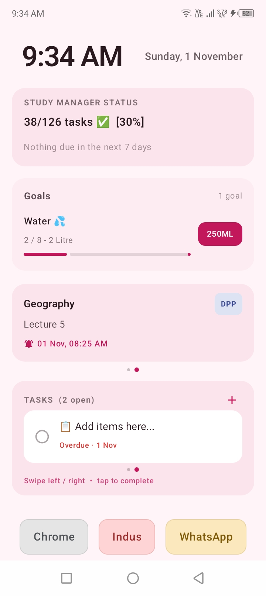
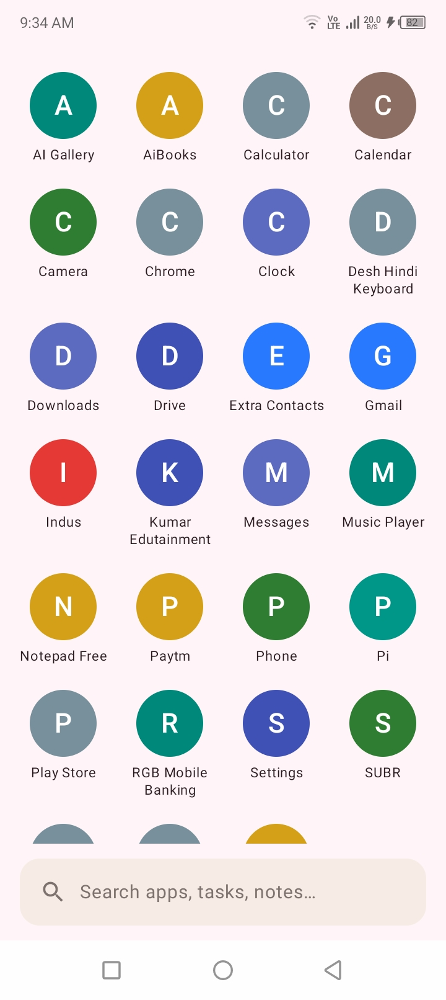
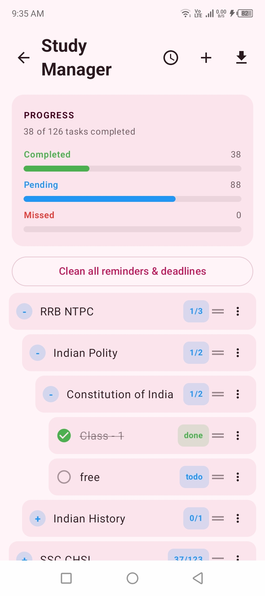
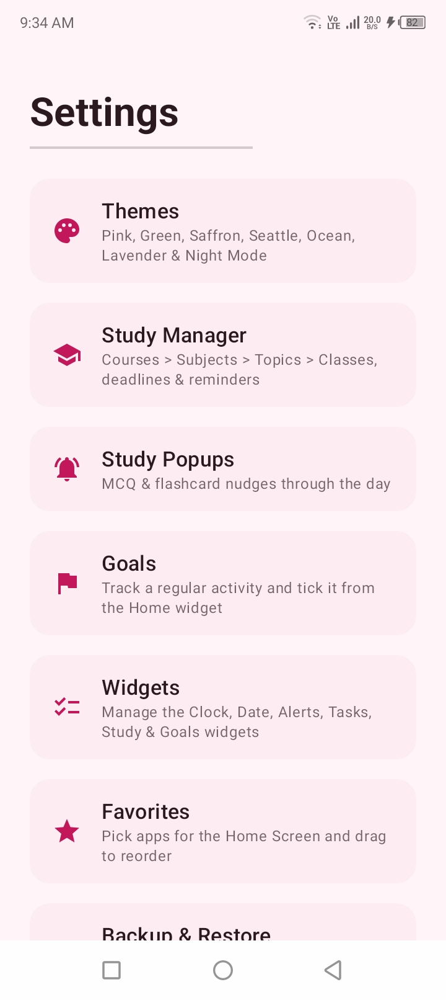
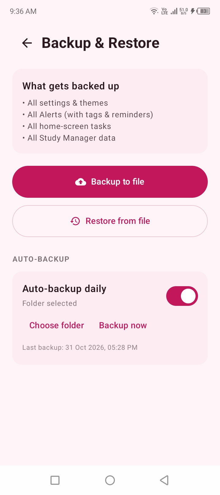

# SP Launcher

A lightweight, student-focused Android launcher built with Kotlin and Jetpack Compose.

SP Launcher replaces your home screen with a simple three-page layout — Settings on the
left, Home in the center, App Drawer on the right — and keeps study close at hand: a study
planner, goals tracker, flashcard reminders and a fast built-in assistant, all designed to
stay smooth on low-RAM phones.

**Private by design.** SP Launcher has no `INTERNET` permission, no analytics, no ads and
no account. Nothing you enter ever leaves your phone.

## Screenshots

| Home | App Drawer |
| --- | --- |
|  |  |

| Study Manager | Settings |
| --- | --- |
|  |  |

| Backup & Restore |
| --- |
|  |

## Features

- **Home** — a clock with date, the Alerts widget (custom tags + optional reminders), a
  tasks checklist, a Goals widget you can tick from the home screen, a Study Manager status
  card (progress + what is due in the next 7 days), an optional **search bar** above the
  Favorites bar (with a mic button for voice search), and the Favorites bar itself, pinned
  to the bottom.
- **Favorites bar** — a taskbar-style row at the bottom of Home. It holds **five slots in
  total**, each one either an app or an app group, and it stays put however many widgets
  are switched on (the widgets scroll above it). Tap a slot to launch, long-press to edit.
- **App groups** — pack up to **four apps into one slot**, so the bar's five slots can hold
  twenty apps. Groups are unnamed: the slot shows the apps' icons in miniature, tap it to
  open them.
- **Real app icons** — the drawer, the Favorites bar and the group sheet use the actual
  launcher icon of each installed app (cached, with a colored initial as fallback).
- **App Drawer** — search, launch, and long-press actions (add to Favorites, app info,
  uninstall). A loading indicator shows while the app list loads, so a first open never
  looks like an empty phone.
- **SP Assistant** — one search over everything: apps, contacts (with Call / SMS /
  WhatsApp buttons right on the result, and the same buttons for a bare phone number
  typed with or without country code), files, tasks, notes, study classes and cards —
  plus a built-in calculator with unit conversion (`45*12`, `5 km in m`), voice input,
  and Google / YouTube shortcuts. Which sources take part is up to you, in
  **Search Settings** (the three-dot menu in the search box); permissions are asked
  lazily, only when a search first needs them.
  - **Files search** covers photos, videos, audio and documents. With **All Files
    Access** granted (a system setting, offered in place when it is missing), search
    also walks your storage on demand — no index — and finds files the media store
    never lists.
- **Goals** — a regular-activity tracker. Each goal is either *limited* (a target, e.g.
  2 litres a day) or *unlimited* (no finish line, it just keeps counting). A goal carries
  a starting text and, for limited goals, an end text it switches to when the target is
  reached, a per-tap value, an optional button label, and an optional daily reset. Goals
  appear in a Home widget and are ticked from there; tapping the card opens the Goals
  screen to add, edit, reset or delete them.
- **Calendar** — a month view of everything dated in the app: study deadlines and
  reminders, task due dates and reminders, note reminders and card review days. Tapping
  a row opens the screen that owns it.
- **Study Manager** — a Course › Subject › Topic › Class tree, with deadlines, reminders,
  drag-and-drop reordering, and JSON / text / PDF export. Completing a task clears its
  Reminder & Deadline automatically, and a **Clean** button clears every task's Reminder
  & Deadline in one tap.
- **Quick Time Table** — set a daily study window and, per subject, its duration, rest
  and sessions per day, pick a 1, 3 or 7 day plan, and the app lays it out from your
  un-completed classes, writing each session's reminder and deadline onto the real
  classes. If the day is too short, nothing is generated and the app shows the exact
  calculation instead.
- **Study Popups** — flashcard reminders delivered as notifications through the day: the
  front of the card, a "Show" button to reveal the back, then True / False grading with
  spaced repetition (wrong cards return after 1, 3, 5 and 7 days). Cards are imported
  from JSON files and organized into decks you can switch on or off. Never shown on the
  lock screen.
- **App Lock** — lock any app behind a 4–6 digit PIN: long-press it in the drawer and
  tap "Lock app". A locked app asks for the PIN every time it opens, and unlocking
  it or changing the PIN needs the current PIN first. The PIN is stored only as a
  secure hash, never in plain text. Locked apps are managed from the search screen's
  menu (**Locked Apps**). Fully offline.
- **Themes** — eight color palettes (Default, Pink, Green, Orange, Grey,
  Ocean, Lavender and the Rainbow palette) plus night mode.
  Automatic schedules — auto night mode and automatic theme change every hour or every
  day — live under **Settings > Automatics**; the rotation steps through every palette,
  Rainbow included. The Rainbow theme offers light animations
  (lamps, rockets and stars) that are off by default, show only on the Home
  screen, and pause automatically when Battery Saver is on.
- **Widgets** — the Clock, Date, Alerts, Tasks, Study and Goals widgets can each be
  switched on or off from the Widgets sheet. Tapping the Clock opens the system Clock
  app; tapping the Date opens the in-app Calendar — or the system Calendar app, if
  that is what "Date opens" is set to in the Widgets sheet.
- **Backup & Restore** — export and import everything as a single JSON file, plus an
  optional daily automatic backup into a folder you pick. If auto-backup is on but its
  folder is missing or no longer accessible, Settings and the Backup screen say so
  clearly instead of letting backups fail silently.
- **Hidden apps (the vault)** — keep selected apps out of the drawer, behind a four-digit
  PIN. Open them from the search screen's menu (**Hidden Apps**), enter the PIN, and
  switch between the **Manage** tab (hide, unhide, change PIN) and the **Launch** tab
  (start a hidden app **without unhiding it first**).

  The default PIN is `1234`.

## Download

Download the latest APK from the
[Releases page](https://github.com/sp-dev-22/sp-launcher/releases) and install it — every
version is published as its own release, so older builds stay available too.

- Android 7.0 and above (`minSdk` 24), `targetSdk` 36
- Small and light: built to run smoothly on low-RAM phones, including Android Go devices

## Building

```
gradle assembleDebug
```

Kotlin, Jetpack Compose, and no third-party runtime dependencies.

## Card file format

Each file is JSON — either a plain list, or an object with a `cards` list:

```json
{
  "deck": "RRB GK",
  "cards": [
    { "front": "Capital of India?", "back": "New Delhi" },
    { "front": "Largest planet in our solar system?",
      "options": ["Jupiter", "Saturn", "Earth", "Mars"], "correct": 1 }
  ]
}
```

`front` is required. Give `back` for the answer, or `options` + `correct` (1-based) for an
MCQ and the back is filled in as `Answer: 1) Jupiter`. `q`/`a` are accepted as aliases.

## What's new in 1.15.0

- **Settings in two tabs**: **Settings** (Themes, Automatics, Widgets, Favorites,
  Backup & Restore, Support, Set Default Launcher) and **Apps** (Study Manager,
  Alerts, Tasks, Study Popups, Goals). Alerts and Tasks open the Widgets sheet on
  their own section.
- **Ocean and Winter merged into Ocean**: the two palettes looked all but identical,
  so Winter is gone — anyone who had Winter saved now gets Ocean, and the frost wash
  and snowfall left with it. The Rainbow wash and animations are untouched.
- **Shorter theme names**: Saffron Orange is now Orange, Seattle Grey is now Grey.
- **Date widget choice**: tapping the Date opens the in-app Calendar as before — or
  the system Calendar app, if that is what "Date opens" is set to in the Widgets
  sheet. Tapping the Clock now opens the system Clock app (it did nothing before).
- **Vault without commands**: the `vault <pin>` / `apps <pin>` search commands are
  gone. The search screen's three-dot menu now holds Search Settings, Hidden Apps
  (PIN first, then Manage / Launch tabs) and Locked Apps.

## What's new in 1.14.0

- **Winter theme**: a cool frost palette (ice-blue and slate) with a soft static
  background — no battery cost. The Rainbow theme and the new Winter theme both take
  part in automatic theme change now.
- **App Lock**: lock any app behind a 4–6 digit PIN from the drawer's long-press menu.
  The PIN is stored only as a secure hash, and unlocking or changing it needs the
  current PIN first. Managed from **Settings > App Lock**.
- **Lighter theme animations, off by default**: the Diwali lamps, rockets and stars
  and a light snowfall are back in a cut-down form (fewer particles, about 30 frames
  per second), on the Home screen only, only with their own theme, and paused while
  Battery Saver is on. Switch them on in **Settings > Automatics**.

## What's new in 1.13.0

- **Files search is complete now**: with All Files Access, search walks your storage on
  demand and finds documents and every other file type — results stream in with a
  "Searching files…" indicator.
- **Home search bar**: the search box also lives on the Home screen, above the Favorites
  bar. Tap it to search; tap its mic to search by voice straight away. It can be hidden
  in Search Settings.
- **Loading indicators** while the app list loads on Home and in the Drawer.
- **Backup hints**: when auto-backup is on but no usable folder is selected (for example
  after a restore, or if the folder was deleted), Settings and the Backup screen tell
  you, and "Backup now" explains exactly what is wrong.
- **Clearer English throughout the app** for users everywhere.

## Notes

- Reminders and card notifications use `AlarmManager.setAndAllowWhileIdle`, so no
  exact-alarm permission is needed.
- On aggressive battery-saving phones, allow the app to auto-start and set battery usage
  to "no restrictions", or background alarms may not fire.
- A launcher needs the `QUERY_ALL_PACKAGES` permission to list the apps installed on the
  phone. The list never leaves the device.
- All Files Access (`MANAGE_EXTERNAL_STORAGE`) is optional and is used only by the files
  search, only when you grant it in system settings.

## Support

SP Launcher is free and has no ads. If it saves you some time, you can send a tip on UPI —
any amount, once, no subscription.

- UPI: `sp.26@ptyes`
- Website: [sp-dev-22.github.io](https://sp-dev-22.github.io/)
- GitHub: [@sp-dev-22](https://github.com/sp-dev-22)
- YouTube: [@SPDev22](https://youtube.com/@SPDev22)
- Email: [somu.22.2026@gmail.com](mailto:somu.22.2026@gmail.com)

## License

[PolyForm Noncommercial License 1.0.0](LICENSE) — Copyright 2026 Somdatt Prajapat.

In plain words: you may read, copy, modify and use this code for **personal,
noncommercial** purposes. You may **not** use it commercially or ship it as a product,
and you may not use it at production level, without permission.

Note that this is deliberately *not* an open-source license in the OSI sense, so the app
is not eligible for F-Droid or other catalogs that require a free-software license.
